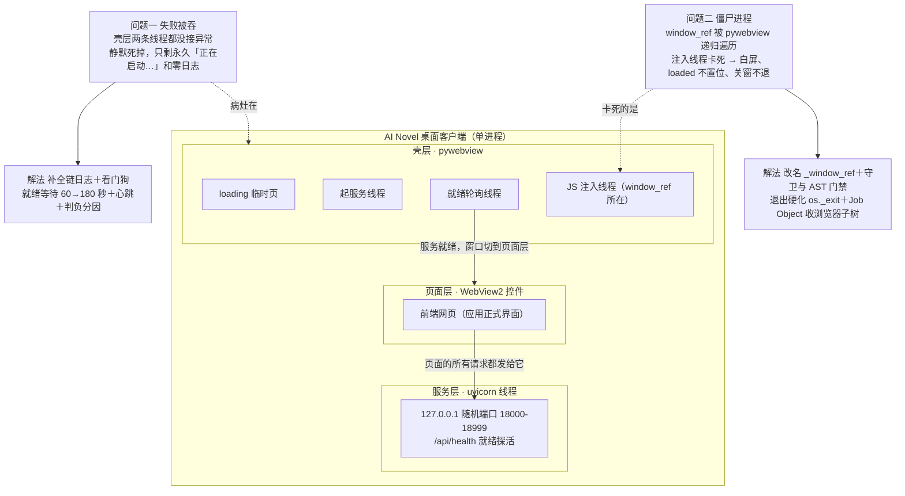

# AI写的代码，装完打不开

这个栏目写的是给 AI 的代码擦屁股。这一篇现场感最强，前天晚上测试同学发来一张截图，Windows 上新装的应用卡在深蓝渐变的「正在启动…」，标题栏写着未响应。装完打不开，昨天修了一整天，深夜发版。

先说启动是怎么回事。这个应用是桌面程序，窗口里装的是网页。壳先弹一个临时的 loading 页压场，后台悄悄起本地服务，服务就绪了再把窗口切到正式页面。截图到手先做判定，那个 loading 页是壳自己的临时页，不是前端页面。也就是说应用从头到尾没走到「服务就绪、切页」这一步，或者切了，但页面永远没装出来。

麻烦在于，旧壳层把失败全都吞了。起服务的线程有一段没接异常处理，装进没写权限的目录，一个权限错就把线程杀了，日志一个字不留。负责等服务就绪的线程也是裸奔，一次异常整条线静默死掉，用户就只看见永久 loading。所以第一步是补日志，从起服务到切页，每一步都写进日志，错误页把两份日志都贴出来，再加一条装载看门狗，60 秒装不出来就开浏览器兜底。

第二轮，用户机现场。装的 v0.28.1，装在 D 盘，首次启动 60 秒服务没就绪，进了错误页，而且后端日志全空。判断是冷启动时杀毒软件实时扫描加慢盘，把启动拖过了 60 秒判罚线。改法，就绪等待从 60 秒放宽到 180 秒，等待期间每 15 秒打一行心跳，判负也分清是哪种死法。用户还甩来一份第三方故障分析，逐条拿日志核对，六条假设该否的全否掉，时序和因果也有对反的地方。

第三轮才轮到真凶。10-06 深夜，用户机三份日志回收到手。startup.log 里 20 点 15 分那次启动全链正常，20 点 20 分那次走到「导航已发出」戛然而止。pywebview.log 里躺着成百上千条 maximum recursion depth exceeded。根因落在一个名字上，NativeBridge.window_ref。AI 给桥接对象挂了个公开属性，指向原生窗口对象。pywebview 注入 JS API 时会递归遍历公开属性来收集可调用对象，只躲开下划线开头的。这一遍历就走进了窗口控件树，再往下是 WebView2 的 COM 对象，后台线程碰它，跨线程连环报错，控件层层下钻，递归上千层，注入线程活活卡死。这条线程一卡，连锁全来，页面白屏，loaded 事件永不置位，关窗后进程赖着不退，任务管理器里的残留进程就是它自己。

修法反而简单得不像话。window_ref 改名 _window_ref，一个下划线，pywebview 就跳过它。再补两道闸，运行期守卫测试钉死「桥接对象的公开面只许有方法」，打包流水线加一个静态检查脚本，再冒出下划线以外的公开属性直接红。顺带把关窗退出也硬化了，窗口关掉后有界收尾然后强制退进程，WebView2 的浏览器子树用 Job Object 收干净，配置文件写入撞上杀毒扫描占用的坑也补了重试。

结果深夜落定。v0.28.2 发版，流水线全绿。中间还出了一次事故，新加的静态检查脚本在 Windows 打包机上 print 中文，控制台编码不认识，门禁脚本自己把发版打挂了一次，输出改成纯 ASCII、重打 tag 才过去。测试全量 1963 条绿。

回头看，这次的雷落在失败处理里，功能本身反倒是干净的。AI 写的壳层把每个失败点都默默接住、默默咽掉，一个「装完打不开」因此变成三轮排查加两晚用户机日志回收。最后定案的修法，是把一个想当然觉得没事的公开名字藏进下划线后面。给这类桌面应用擦屁股，记住一条就够了，AI 写的守护代码，越安静越可疑。

## 明日

测试同学换 v0.28.2 包真机复验，第二次启动不白屏、关窗无残留。归档 c-shell-render-resilience 和 c-shell-hang-hardening 两个 change。单实例互斥立项，双开真丢稿的数据安全项。
